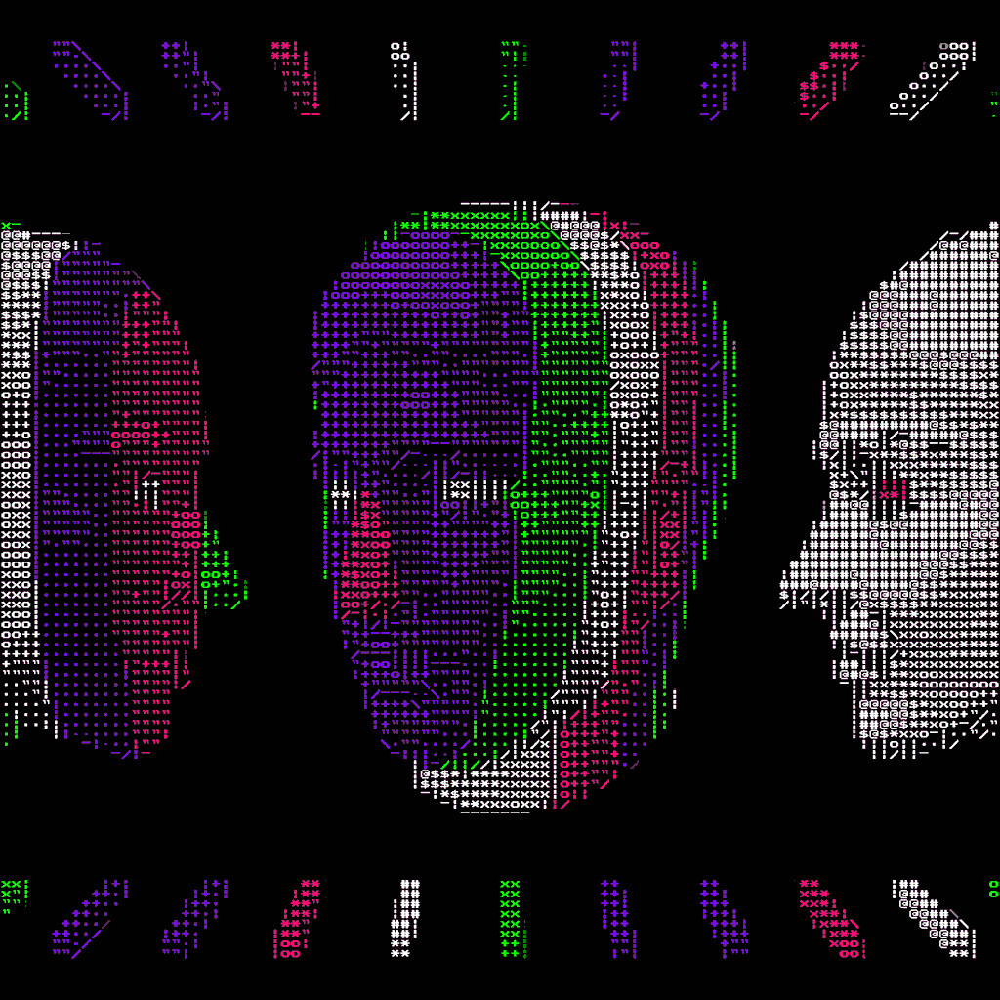

# Eyes Are the Window to the Soul

### ASCII Animation Series · Homesh Peter Paul

> “The eyes are the window to the soul.”


Rotating ASCII faces release streams from their eyes. Purple, pink, and green characters form the faces, while **HOMESH** travels with each outgoing eye stream.

`eyes.py` is self-contained: the animation is embedded in the file, so playback and export work with no external assets and no network access.

## Inspiration

The piece starts from the saying itself and takes it literally. If the eyes are a window, then something should be visible moving through it — so the faces never hold still. They rotate, tilt, and settle as characters, and every time a face turns outward a stream leaves the eyes, carrying **HOMESH** with it and dissolving into the plume rather than sitting on the face as a label.

Rotation does the expressive work. A face that turns away closes the window; a face that turns back offers it again, and the outgoing stream is the one moment the name is legible. Purple, pink, and green characters shape the faces so the light in the eyes registers before any letter does.

## Preview



[Watch the landscape video](eyes_landscape.mp4)

## Features

- Self-contained Python animation; no external assets required.
- 191 frames at 1024 × 1024, looping over 7.64 seconds.
- HOMESH lettering synchronized with the outgoing eye streams.
- Adjustable color palette and playback window size.
- Looping GIF export and 1920 × 1080 landscape video export.

## Requirements

| Dependency | Needed for |
| --- | --- |
| Python 3.10 or newer | Running `eyes.py` |
| [Pillow](https://python-pillow.org) | Playback and every export |
| Tkinter (bundled with python.org builds) | The desktop playback window |
| [imageio-ffmpeg](https://github.com/imageio/imageio-ffmpeg) | Video export (`.mp4`, `.mov`, `.mkv`, `.webm`) |

```sh
python3 -m pip install -r requirements.txt
```

## Getting started

Run these commands from the folder containing `eyes.py`:

```sh
python3 eyes.py
```

The animation opens in a desktop window. Preparing the frames takes a few seconds, since every frame is recolored and lettered on load.

| Key | Action |
| --- | --- |
| Space | Pause or resume |
| Escape | Close the window |

Desktop playback requires Tkinter. GIF and video exports run without opening a window.

## How it works

1. The embedded animation is decompressed and each frame is hue-rotated in HSV space, leaving luminance detail, alpha, and black pixels untouched.
2. Every frame is composited on black, and the HOMESH inscription is drawn along the outgoing eye plume from hand-keyed positions tied to the frame index.
3. Playback draws those finished frames in a Tk window; exports write the same frames to a GIF or a video file.

Every frame keeps its rasterized glyphs instead of being re-typeset, so the characters stay pixel-exact.

## Command-line reference

| Option | Default | Description |
| --- | --- | --- |
| `--source PATH` | built-in animation | Read a different animated GIF instead |
| `--hue DEGREES` | `150` | Hue rotation; `0` keeps the original colors |
| `--size PIXELS` | `800` | Playback window size |
| `--export PATH` | — | Write a file instead of opening a window |
| `--video-size WxH` | `1920x1080` | Landscape canvas for video export |
| `--fps RATE` | from the frame delays (`25`) | Video frame rate |

## Customize

```sh
# Change the playback window size
python3 eyes.py --size 700

# Choose another color palette
python3 eyes.py --hue 240

# Use the original colors
python3 eyes.py --hue 0
```

The default hue rotation is `150` degrees.

## Export

### Animated GIF

```sh
python3 eyes.py --export eyes.gif
```

Exports a looping 1024 × 1024 GIF with the animation's frame timing.

### Landscape video

```sh
python3 eyes.py --export eyes_landscape.mp4
```

Exports an H.264 MP4 at 25 fps on a black 1920 × 1080 canvas, with the square artwork centered. Video export uses `imageio-ffmpeg`, included in `requirements.txt`.

To change the canvas size and frame rate:

```sh
python3 eyes.py --export eyes_landscape.mp4 --video-size 2560x1440 --fps 30
```

`--export` chooses the format from the file extension: `.mp4`, `.mov`, `.mkv`, and `.webm` produce video, anything else produces a GIF. Video files do not loop on their own, so repeat the clip in your player or editor if you need a seamless loop.

## Files

| File | Purpose | Size |
| --- | --- | --- |
| `eyes.py` | Self-contained animation player and exporter, with the animation embedded | ~17 MB |
| `requirements.txt` | Python dependencies | < 1 KB |
| `eyes.gif` | Animated preview export, 191 frames at 1024 × 1024 | ~20 MB |
| `eyes_landscape.mp4` | Landscape video export, 1920 × 1080 at 25 fps | ~8 MB |

## Credits

- **Title:** Eyes Are the Window to the Soul
- **Series:** ASCII Animation Series
- **Built by:** Homesh Peter Paul
- **Inspiration:** “The eyes are the window to the soul.”
